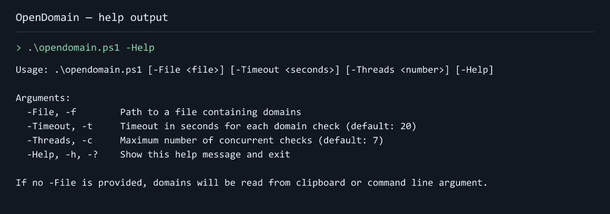

# OpenDomain

OpenDomain checks batches of domain names from PowerShell, reducing the repeated lookup work involved in reviewing a list of possible names. Supply a domain directly, read a file, or use clipboard input, then collect the results in a timestamped log.

It uses RDAP first and falls back to WHOIS when needed. Configurable concurrency and timeouts help you work through larger lists while accounting for slow registry responses. This is useful for an initial naming shortlist or a repeatable domain-checking workflow, with registrar confirmation still needed before registration decisions.



*Actual output captured from running .\opendomain.ps1 -Help, presented as a readable help-output image.*

## Get started

Requires Windows and PowerShell 5.1 or later. Keep the bundled `whois.exe` beside the script for WHOIS fallback.

```powershell
.\opendomain.ps1 example.com
```

To check domains from a file:

```powershell
.\opendomain.ps1 -File domains.txt -Timeout 15 -Threads 10
```

## Input and output

Domains can come from command-line input, a file, or the clipboard. Requests run concurrently with configurable timeouts, and results are written to a timestamped log in the script directory.

```powershell
.\opendomain.ps1 -Help
```

Results depend on the registry services responding; confirm a domain's current status with a registrar before acting on it.
